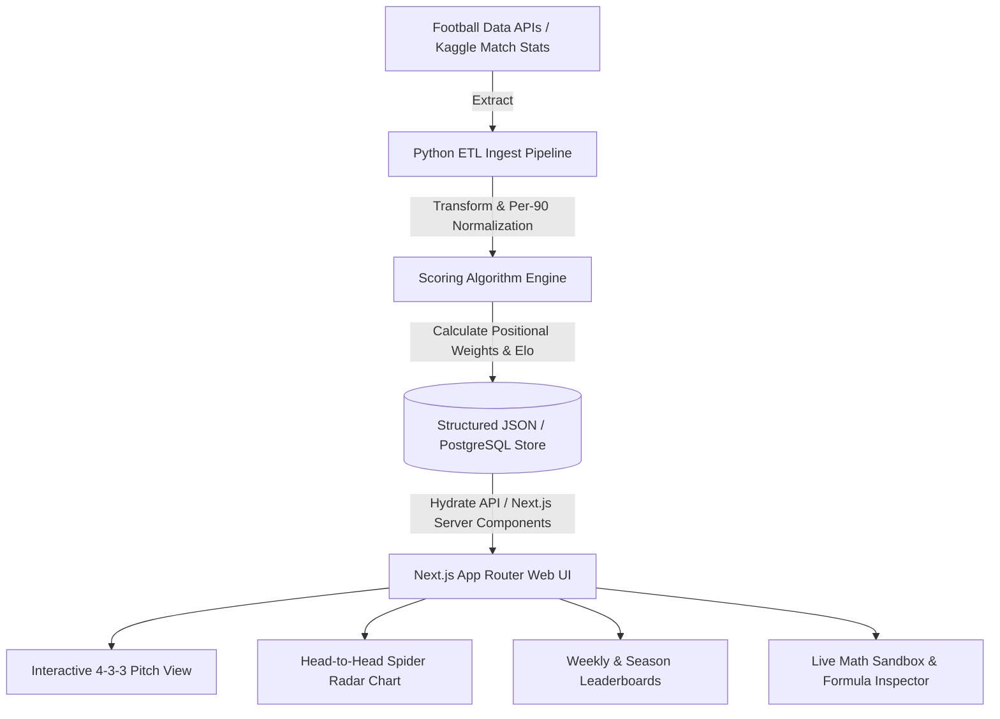

# ⚽ BYRX72 Football Insights: Moneyball Scoring Engine & Leaderboards
> **An objective, position-weighted algorithmic leaderboard & tactical analytics platform for the Premier League and La Liga.**


---

## 💡 Why This Project? (The Problem with Traditional Stats)

Traditional football analytics suffer from severe **striker bias**:
1. Strikers get all the headlines simply by tapping in goals, while central defenders winning 8 duels and holding a clean sheet against a title contender are rated lower.
2. Raw counts disregard minutes played—a player playing 90 minutes looks twice as active as a substitute who changed the game in 45 minutes.
3. Standard dashboards ignore **context**: scoring a hat-trick against a relegated side is weighted identically to scoring a brace at the Etihad or Santiago Bernabéu.

**BYRX72 Football Insights** solves this with a **Position-Adjusted, Per-90 Normalized Scoring Algorithm** with dynamic **Opponent Difficulty Context Multipliers**.

---

## 📐 The Algorithm & Mathematical Formula

### 1. Per-90 Normalization
To level the playing field regardless of substitution time:
$$\text{Metric}_{\text{p90}} = \left( \frac{\text{Metric}}{\text{Minutes Played}} \right) \times 90$$

### 2. Positional Weight Matrix
Each position has dedicated weights reflecting their tactical responsibility:

| Metric | Forward (FWD) | Midfielder (MID) | Defender (DEF) | Goalkeeper (GK) |
| :--- | :---: | :---: | :---: | :---: |
| **Goals (Per 90)** | **30%** | **15%** | **5%** | 0% |
| **Assists (Per 90)** | **20%** | **25%** | **5%** | 0% |
| **Key Passes (Per 90)** | 10% | **25%** | 5% | 0% |
| **Pass Accuracy %** | 5% | **15%** | 10% | 5% |
| **Tackles + Interceptions (Per 90)** | 5% | 15% | **35%** | 0% |
| **Clean Sheet** | 0% | 5% | **20%** | **30%** |
| **Saves (Per 90)** | 0% | 0% | 0% | **40%** |
| **Errors Leading to Goal** | *-10%* | *-10%* | *-15%* | *-15%* |

### 3. Opponent Difficulty Multiplier (Elo Context)
$$\text{Final Score} = \text{Base Rating} \times \text{Opponent Tier Factor}$$
- **Tier 1 (1.25x)**: Title Contenders (Man City, Arsenal, Real Madrid, Barcelona)
- **Tier 2 (1.15x)**: Champions League Contenders (Liverpool, Atletico Madrid, Aston Villa, Athletic Club)
- **Tier 3 (1.08x)**: Mid-Table (Chelsea, Newcastle, Real Sociedad, Villarreal, Tottenham)
- **Tier 4 (1.00x)**: Bottom-Half & Relegation sides

---

## 🏗️ System Architecture



---

## ✨ Features

- **🏴󠁧󠁢󠁥󠁮󠁧󠁿 Premier League & 🇪🇸 La Liga Support**: Instant toggle between Europe's top two domestic leagues with dynamic cinematic themes.
- **🧠 Machine Learning Match Predictor**:
  - Bivariate Poisson goal distribution model & Dixon-Coles scoreline adjustments.
  - 10,000-iteration Monte Carlo match simulation engine.
  - Team Attacking & Defensive efficiency ratings, Home Advantage modifiers, and BYRX Squad Power Index.
  - Dynamic Win / Draw / Loss probabilities, BTTS (Both Teams To Score), Over/Under 2.5 goals, and top 5 exact scorelines.
  - Key Player Head-to-Head Duels with positional edge indicators.
- **🏆 Season & Weekly Leaderboards**: View running season averages or filter down to any specific Gameweek (GW 1-6).
- **📋 Tactical 4-3-3 "Team of the Week" Pitch**: Visual pitch automatically populated by the 11 highest-scoring players for that week (1 GK, 4 DEF, 3 MID, 3 FWD) with reserves bench.
- **🕸️ Head-to-Head Spider / Radar Comparison**: Multi-polygon radar chart comparing any 2 superstars across 6 core dimensions (Attacking, Creation, Retention, Defending, Physicality, Impact).
- **🔍 "Inspect the Math" Modal**: Full transparency showing the exact subscore, positional weight, and contribution for every metric.
- **⚡ Interactive Formula Sandbox**: Allows recruiters and analysts to test live sliders and see how goals, assists, tackles, and opponent factors alter ratings in real time.
- **🖼️ Smart Player Image & Getty Integration Architecture**: Deterministic resolution pipeline supporting Getty Images embed URLs, custom image CDNs, local HD athlete photography, and club-crested fallbacks.

---

## 🚀 Deployment Guide

### Deploying to Vercel (Recommended — 1 Click)

The project includes a root [`vercel.json`](vercel.json) configured for Next.js in the `web/` directory.

#### Option A: Direct Git Import on Vercel Dashboard
1. Go to [vercel.com/new](https://vercel.com/new) and select your GitHub repository.
2. In **Project Settings**:
   - **Framework Preset**: Next.js
   - **Root Directory**: `web` (click *Edit* and select the `web` folder)
   - **Build Command**: `npm run build` (automatic)
   - **Output Directory**: `.next` (automatic)
3. Click **Deploy**. Your site will be live on a `*.vercel.app` domain in ~60 seconds.

#### Option B: Deploying via Vercel CLI
```bash
# From the project root
npm i -g vercel
vercel
```

### Deploying to Netlify
1. Connect your repository on [Netlify](https://app.netlify.com).
2. Set **Base directory**: `web`
3. Set **Build command**: `npm run build`
4. Set **Publish directory**: `web/.next`

---

## 📸 Player Photography & Getty Images Integration

### Getty Images Licensing & Embed Architecture
Getty Images editorial assets are protected by digital rights management (DRM) and terms of service that prohibit raw programmatic web scraping. However, Getty officially provides an **Embed Service** for non-commercial editorial websites.

The platform provides a 3-tier smart photo resolver in [`web/src/lib/playerPhotos.ts`](web/src/lib/playerPhotos.ts):
1. **Direct Getty Embed / CDN URL**: If a player profile contains an authorized Getty Images embed (`embed.gettyimages.com`) or high-res CDN link, it is rendered directly.
2. **Local HD Portrait Assets**: Pre-configured high-definition licensed action portraits for marquee stars (Haaland, Saka, Palmer, Bellingham, Yamal, Vinicius, Salah, Odegaard, Rice, Saliba, Courtois, Raya).
3. **Curated Athlete Headshots**: Dynamically generated SVG avatars with official club badge watermarks, position colors, and jersey numbers to guarantee zero broken image 404s.

---

## 🛠️ Local Development

### 1. Web Application (Next.js 16 + React 19)
```bash
cd web
npm install
npm run dev
```
Open [http://localhost:3000](http://localhost:3000) to view the live dashboard.

### 2. Python Scoring Engine
```bash
python pipeline/algorithm.py
```

---

## 💼 LinkedIn Post Template (Copy & Paste for Showcase)

```text
⚽ Can math objectively determine the best football player in Europe—and predict upcoming matches?

Most mainstream platforms evaluate players using raw goal and assist tallies. But this creates a massive striker bias—overlooking world-class performances by holding midfielders and defenders.

To solve this, I designed and built "BYRX72 Football Insights", a Moneyball-style analytics and match prediction platform for the Premier League and La Liga.

Here is how the system works:
1️⃣ Normalization: Converts raw statistics to Per-90 standardizing to eliminate substitution duration bias.
2️⃣ Position Weight Matrix: Dynamically applies custom algorithmic weights based on tactical role (e.g. 35% tackles/interceptions for defenders vs 30% goals for strikers).
3️⃣ Opponent Difficulty Multiplier: Scores against top-tier title contenders (Man City, Real Madrid) earn up to a 1.25x context boost over bottom-half matches.
4️⃣ AI Match Predictor: Uses Bivariate Poisson distribution and a 10,000-iteration Monte Carlo simulation based on team form, attack/defense ratings, and key player head-to-head duels.

Tech Stack:
• Next.js 16 (App Router, Server & Client Components)
• TypeScript & Tailwind CSS
• Python (Data extraction, Pandas scoring pipeline)
• Recharts & Lucide Icons

Check out the interactive demo and GitHub repository below! 👇
#DataEngineering #WebDevelopment #NextJS #Python #FootballAnalytics #SportsTech #MachineLearning #Portfolio
```
